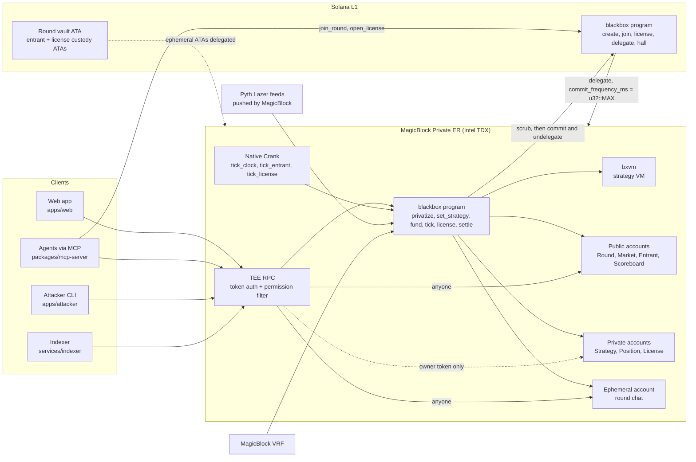

# BLACKBOX

**Alpha you can't read.**

BLACKBOX is a trading league where every strategy is a small program that only its author can read. The BLACKBOX program runs each strategy inside a MagicBlock Private Ephemeral Rollup (PER) on every Native Crank tick, against Pyth Lazer prices, and trades a perps book with real (test) USDC. Rivals and spectators see a live equity leaderboard and nothing else. A winning strategy can be **licensed blind**: a backer puts up margin and the crank runs the author's sealed bytecode against the backer's own private book, at a fee the program prices inside the TEE from the author's private Sharpe ratio. When the round ends, the program settles every book and every license, publishes the sha256 of each final strategy, zeroes the private state, and commits the results to Solana.

| | Status (2026-09-11) |
|---|---|
| BLACKBOX program on devnet | **Deployed.** `BXAbfrYjTM7WQ7K6Rrj1epcQwd6jT3TTXs3yqTp1dx27`, 928,832 bytes, deploy tx [`3juU6d7k…`](https://explorer.solana.com/tx/3juU6d7ktbdE5Wmc4XdN5boqfZCFf2y7oRF4PqVkbA4PncU5NGLEp1GvUYCfz8wsdjohSuhG9oNmJbNq7PKiYGtq?cluster=devnet) |
| Full round on devnet + devnet-tee | **Verified**, 43/43 checks (`CLUSTER=devnet` on `tests/blackbox.e2e.ts`) |
| Full round on the local MagicBlock stack | **Verified**, 43/43 (see [Verification](#verification)) |
| Every MagicBlock primitive BLACKBOX depends on | **Verified**, 32/32 checks (`tests/spike.ts` on devnet + devnet-tee, log in [`docs/design/verification.md`](docs/design/verification.md)) |
| Blind licensing (back a strategy without reading it) | **Shipped.** `open_license` through `undelegate_license`; exercised in the devnet run: the crank ticked the license, the author was paid its accrued fees, and the License came back to L1 as 560 zero bytes. |
| Round chat, house bankroll, vault sweep | **Shipped.** `post_chat` / `close_chat` (an ephemeral, ER-only account), `seed_vault` / `sweep_vault`. |
| Web app, BXL compiler, MCP server, LLM agents, attacker CLI, indexer | **Built.** Test counts in [Verification](#verification); caveats in [Repository map](#repository-map). |
| Mainnet | **Not attempted.** No mainnet deployment, no real USDC. |

Deeper reading: [architecture](docs/ARCHITECTURE.md), [disclosures](docs/DISCLOSURES.md), [demo script](docs/DEMO.md).

---

## Why this needs a Private Ephemeral Rollup

The product is a program that executes code no client can query. Every other place to put that code fails:

- **Solana L1.** Account data is public. A strategy stored on-chain is readable the moment it lands, and the transaction that uploads it carries the bytes in its message.
- **Off-chain.** A server that runs your strategy is a "trust me" bot. Nobody can check that the strategy that traded is the one that was submitted, or that the books were marked honestly.
- **A plain Ephemeral Rollup.** Fast and cranked, but its RPC serves every account to anyone who asks.
- **A Private Ephemeral Rollup.** The validator runs inside an Intel TDX enclave, and its RPC filters every read through ephemeral permissions. The BLACKBOX program can read a `Strategy` account on every tick; the RPC hands that account only to its owner's auth token. The crank runs inside the rollup, so there is no keeper that sees the code. Delegation with `commit_frequency_ms = u32::MAX` means nothing is written back to L1 until the program has scrubbed it.

Program-readable, client-unreadable state is the primitive. BLACKBOX is built on it. Blind licensing is what that primitive buys you that nothing else does: the buyer's capital trades on code the buyer never receives.

## How a round works

1. **Create (L1).** The admin calls `create_round` (Round, Scoreboard, a USDC vault owned by the Round PDA whose ephemeral ATA is delegated to the TEE validator; the Round is also pre-funded with the rent for its permission and for the round chat), `add_market` per perp (SOL, BTC, ETH, each bound to its Pyth Lazer price account), then `open_round`.
2. **Join (L1).** Each entrant calls `join_round`. It creates their public `Entrant`, their `Strategy` (zeroed, 4 KB of code space) and `Position` (zeroed), and a custody token account owned by the Entrant PDA. `delegate_entrant` delegates all three to the TEE validator with `commit_frequency_ms = u32::MAX`.
3. **Delegate the round (L1).** `delegate_market` and `delegate_round` move the Markets, Round and Scoreboard into the TEE rollup.
4. **Deposit (L1 to ER).** Each entrant moves USDC into the rollup with Ephemeral SPL (`delegateSpl`). One deposit per wallet per round: a top-up goes through the eSPL shuttle, which the local stack's eSPL program rejects.
5. **Privatize (ER).** `privatize_entrant` creates ephemeral permissions on `Strategy` and `Position` with one member, the owner. From here only the owner's TEE auth token can read them.
6. **Upload (ER).** `set_strategy` validates the bytecode with `bxvm::validate` and writes it into the private `Strategy`. The bytes exist only in this ER transaction, whose message the permission hides from non-members, and in the private account.
7. **Fund (ER).** `fund_entrant` moves the entry fee into the round vault (the prize pot) and margin into the entrant's custody account, both as real SPL transfers on the rollup.
8. **Bankroll (ER).** `seed_vault` lets anyone add USDC to the round vault. The vault is the counterparty of every book, so a bankroll means a profitable entrant is paid in full whatever order settlement runs in. `scripts/run-round.ts` seeds 2,000 test USDC from a fresh house wallet and sweeps what is left back at the end.
9. **Start (ER).** `start_round` flips the round live, `request_round_seed` asks MagicBlock VRF for the round seed, `schedule_clock` schedules the round clock on the Native Crank, and `schedule_entrant_tick` schedules one tick task per entrant.
10. **Trade (ER, every tick).** `tick_clock` advances the round tick, bounded by wall time so it can never run ahead of the schedule. Each `tick_entrant` refreshes market indicators from the oracle, runs the entrant's strategy in the VM, applies its orders to the private Position, marks to market, liquidates if equity falls below maintenance, updates the entrant's private Sharpe accumulators, republishes its public blind price, and writes equity, trade count and alive flag to the public Scoreboard. Each entrant runs at most once per round tick. Owners can hot-swap their strategy with `set_strategy` at any time while live.
11. **License (L1 + ER, any time before settling).** A backer calls `open_license` and `delegate_license` on L1, deposits USDC into the rollup, then `activate_license` on the ER: that creates a permission whose members are the buyer and the author, moves the margin into the License's own custody account, and locks the fee at the author's current public blind price. `schedule_license_tick` puts the license on the crank; `tick_license` runs the **author's** private bytecode against the **buyer's** private book every tick. The buyer never reads the code: the Strategy permission lists only the author.
12. **Chat (ER).** `post_chat` writes into a 32-message ring buffer that lives only on the rollup, sponsored by the Round PDA. Anyone can post 1-79 printable characters while the round is open or live, and anyone can read it.
13. **Settle licenses (ER).** `settle_license` closes the license's legs at the final marks, settles its PnL against the vault, pays the author the fees accrued on traded notional, returns the rest to the buyer, scrubs the License and leaves its permission open (it redacts the licence's rollup transactions); `undelegate_license` commits zeros to L1. `close_round` and `sweep_vault` refuse to run while any activated license is unsettled (`Round.open_licenses`).
14. **Settle entrants (ER).** `settle_entrant` closes every leg at the final marks, moves real USDC between custody and vault, pays the owner, writes `sha256(final bytecode)` to the Entrant and Scoreboard, and zeroes the private bodies. Their permissions stay open on purpose: the same permission redacts the rollup transactions that carried the bytecode, so closing it would expose every past upload. `undelegate_entrant` refuses to commit unless the private bodies are all zeros, then commits and undelegates.
15. **Rank, pay, sweep, close (ER).** `rank_round` ranks by return on deposit, `pay_prizes` splits the pot (after the protocol fee) 50/30/20 to the top three, `sweep_vault` sends what is left in the vault to a destination the admin chooses, `close_chat` refunds the chat's rent to the Round, and `close_round` commits and undelegates the Round, Scoreboard and Markets.
16. **Record (L1).** `record_hall` folds each result into the entrant's Hall of Fame record (rounds, wins, podiums, PnL, ELO).

The full instruction reference, account layouts and math are in [docs/ARCHITECTURE.md](docs/ARCHITECTURE.md).

## MagicBlock primitives

| Primitive | What BLACKBOX uses it for | Where in the code |
|---|---|---|
| Private Ephemeral Rollup (TEE validator `MTEWGuqxUpYZGFJQcp8tLN7x5v9BSeoFHYWQQ3n3xzo`) | The whole round runs inside it: strategies execute, positions are marked, USDC moves. | Round pinned to a validator in `create_round` (`programs/blackbox/src/instructions/admin.rs`); endpoints in `packages/sdk/src/constants.ts` |
| TEE auth tokens + query filtering | Owners read their own Strategy and Position; a backer and the author read their License; everyone else gets `null`. | `BlackboxClient.tee()` / `teePublic()` in `packages/sdk/src/client.ts` |
| TDX attestation | Clients check the enclave before trusting it (`verifyTeeRpcIntegrity`). | `BlackboxClient.verifyAttestation()` in `packages/sdk/src/client.ts`; `tests/spike.ts` |
| Ephemeral permissions (access control) | One-member permissions on Strategy and Position, two-member (buyer + author) on a License, flags `TX_LOGS`, `TX_MESSAGE`, `TX_BALANCES`; program-only Scoreboard in dark rounds; all closed before undelegation. | `programs/blackbox/src/privacy.rs`; `privatize_entrant` in `instructions/entrant.rs`; `activate_license` in `instructions/license.rs`; `set_scoreboard_privacy` in `instructions/round.rs`; `settle_entrant` in `instructions/settle.rs` |
| Ephemeral (ER-only) accounts | The public round chat: a ring buffer that is created on the rollup by the first post, sponsored by the delegated Round PDA, and closed before the round commits. It never exists on L1. | `programs/blackbox/src/instructions/chat.rs` (`#[ephemeral_accounts]`, `create_ephemeral_chat` / `close_ephemeral_chat`) |
| Delegation with `commit_frequency_ms = u32::MAX` | No timer commits: private state reaches L1 only through the scrub-then-commit path. | `NEVER_AUTO_COMMIT_MS` in `programs/blackbox/src/constants.rs`; `delegate_*` in `instructions/admin.rs`, `instructions/entrant.rs`, `instructions/round.rs`, `instructions/license.rs`, `instructions/mock.rs` |
| Commit and undelegate (Magic intent bundles) | Scrubbed entrant and License accounts, then Round, Scoreboard and Markets, go back to L1. | `undelegate_entrant`, `close_round` in `instructions/settle.rs`; `undelegate_license` in `instructions/license.rs` |
| Native Crank (`ScheduleTask`) | One clock task per round, one tick task per entrant, one per license, 400-500 ms interval, no off-chain keeper. Tasks get slack iterations so a lagging crank still reaches the last tick. | `schedule`, `crank_slack`, `schedule_clock`, `schedule_entrant_tick` in `instructions/tick.rs`; `schedule_license_tick` in `instructions/license.rs` |
| Price oracle (Pyth Lazer accounts pushed by MagicBlock) | Marks, EMA(8/21/55), ring-buffer returns and realized volatility per market, read directly inside the TEE with a 5 s staleness bound. | `programs/blackbox/src/oracle.rs`; market refresh in `load_markets` |
| Ephemeral SPL | Entry fees, margin, PnL, license fees, the house bankroll and payouts move as real token transfers on the rollup, signed by program PDAs (round vault, entrant custody, License custody). | `programs/blackbox/src/espl.rs`, `instructions/fund.rs`, `instructions/vault.rs`, `instructions/settle.rs`, `instructions/license.rs`; `depositToEr` / `withdrawFromEr` in the SDK |
| VRF (delegated queue) | Round seed for the `RAND` opcode and a VRF-chosen mystery market. | `programs/blackbox/src/instructions/vrf.rs` |
| Local MagicBlock stack | `mb-test-validator`, `ephemeral-validator`, `query-filtering-service`, `vrf-oracle` for a full local round. | `scripts/local-stack.sh` |

Session keys and the Magic Router are **not** used: every transaction is signed by the wallet it belongs to, and clients address the base layer and the TEE endpoint directly.

## Verification

| Suite | Where | Result | What it proves |
|---|---|---|---|
| End-to-end round, `tests/blackbox.e2e.ts` | devnet + devnet-tee | **43/43**, 2026-09-12 (4 entrants, 400 ms ticks, 90 ticks, round #1 `EHfSy9AY…`) | TDX quote verified; live Pyth Lazer SOL/BTC/ETH; L1 setup with the Strategy bytecode region empty on L1; delegation; real USDC deposit, entry-fee pot, margin and a 520 USDC vault after the bankroll; privacy matrix (owner reads and disassembles; stranger, no-token and rival reads `null`); VRF seed lands (mystery market 1); crank clock reaches tick 26 in 327 ms; 13 trades; a blind price published for entrant 0; license privacy (backer reads its own License, the author reads it too, a stranger gets `null`, and the backer cannot read the strategy it runs); the crank ticks the license (2 trades); the round chat readable by anyone and absent from L1; mid-round hot-swap; license settled (author paid 0.6 USDC of fees at 5 bps, backer returned 99.188051 USDC) and back on L1 as 560 zero bytes; all 12 entrant accounts undelegated in 3 s with zero private bodies; published hash equals sha256 of the final bytecode; prizes 9.5 / 5.7 / 3.8 USDC; vault swept (503.399664 USDC of bankroll, net losses and protocol fee); chat closed before the commit; Hall of Fame updated (winner ELO 1016); round settled on L1 with `vault_balance` 0. |
| End-to-end round, `tests/blackbox.e2e.ts` | local stack | **43/43**, 2026-09-12 | The same check list, run against the opt-level "z" build that is deployed on devnet: all 12 entrant accounts undelegated in 25 s with zeroed private bodies, the licence settled (author paid 1.197362 USDC at 5 bps, backer returned 98.50615 USDC), the vault swept 502.02348 USDC to the house, the chat closed before the commit. An earlier run scored 40/42 when one undelegation commit missed the check's old 60 s window; that check now polls all 12 accounts together for up to 3 minutes. The suite passed 27/27 before licensing, the chat and the bankroll were added. |
| Phase 0 integration spike, `tests/spike.ts` against `programs/spike` | devnet + devnet-tee | **32/32**, 2026-09-11 | TDX attestation; owner token reads a private account while no-token and stranger-token reads return `null`; a non-TEE regional ER only sees the stale L1 copy; the secret-writing transaction's message is hidden from non-members; no timer commit leaks the secret to L1; Native Crank ticks fire inside the TEE and read a live Pyth Lazer price; Ephemeral SPL user-to-vault transfer and PDA-signed payout on the TEE, with token balances hidden from other wallets; ephemeral accounts with permissions; VRF callback lands in the TEE (318-557 ms); permissions closed, state scrubbed, committed and undelegated with zeros on L1. Details and gotchas: [`docs/design/verification.md`](docs/design/verification.md). |
| Read-attack matrix, `apps/attacker/test/matrix.test.ts` | local stack | **12/12** | Against a live local round: no-token, fresh-wallet and rival-token reads of Strategy and Position; `getMultipleAccounts` and `getProgramAccounts`; a stranger's `getTransaction` on `set_strategy`; the L1 copies and the delegation PDAs; and the owner-token control read that must succeed. |
| Program unit tests, `cargo test -p blackbox` | native | **8/8** | Open and close PnL, leverage and OI caps, side flip, indicators and returns, incremental realized volatility against a full recompute, exact integer square root, skew-dependent spread. |
| VM unit tests, `cargo test -p bxvm` | native | **8/8** | EMA-cross program emits the right action; a fault discards actions; the step limit stops infinite loops; memory persists across ticks; fixed-point math saturates; 2,000 random programs never panic. |
| BXL compiler, `packages/compiler/test` | native | **86/86** | Parsing, codegen and error reporting for BXL, the simulator, and behavioural equivalence between every BXL example and the hand-assembled SDK bot it ports. |
| TS/Rust VM parity, `packages/sdk/test/vm.test.ts` | native | **3/3** | Every built-in strategy validates identically in the TypeScript assembler and in `bxvm`, with the same instruction boundaries; both reject the same malformed programs. |
| MCP server, `packages/mcp-server/test` | native | **21 passing, 11 pending** | Tool schemas, formatting and round-file handling. The pending tests are the live end-to-end flow, gated behind `BLACKBOX_MCP_E2E=1`. |
| Agents, `packages/agents/test` | native | **32/32** | The provider bridge (Claude, OpenAI, Gemini, scripted), the tool loop's guards (one license per loop, a decision that matches what the loop actually did) and the runner. |
| Web app, `apps/web/test` | native | **50/50** | Number and amount formatting (13), the disclosures parser against `docs/DISCLOSURES.md`, chat encoding, license instruction building, the proof view, round-file reading and chain helpers. |
| Indexer, `services/indexer/test` | native | **8/8** | Public round polling, history and the SSE stream. |

Not verified: mainnet (not attempted); the web app's devnet wallet flow for blind licensing (the UI detects that the program is missing on a cluster and says so, but the flow itself has only been run on local); dark-mode rounds (implemented, run by `MODE=dark` in `scripts/run-round.ts`, not covered by the e2e suite); and the user withdrawal path `withdrawFromEr` (implemented in the SDK, not covered by the e2e suite).

## Architecture



## Repository map

| Path | What it is | Status |
|---|---|---|
| `programs/blackbox` | The Anchor 1.1.2 program: rounds, markets, entrants, privacy, crank ticks, perps engine, blind licensing, round chat, house bankroll, settlement, Hall of Fame. Program id `BXAbfrYjTM7WQ7K6Rrj1epcQwd6jT3TTXs3yqTp1dx27`. | Deployed on devnet (e2e 42/42), working locally |
| `crates/bxvm` | The strategy VM: `no_std`, 42 opcodes, i64 fixed point, validator, assembler, disassembler. | Working (8/8 unit tests) |
| `packages/sdk` (`@blackbox/sdk`) | `BlackboxClient` (L1 + TEE connections, one method per protocol step, licensing, chat, bankroll, reads), PDA helpers, TS assembler/disassembler/validator, built-in bot strategies, generated IDL. | Working |
| `packages/compiler` (`@blackbox/compiler`) | BXL, the strategy language: `compile`, `simulate`, `formatListing`, `EXAMPLES`. | Working (86/86) |
| `packages/mcp-server` | MCP server that lets an AI agent join a round, write BXL, hot-swap, back another entrant's sealed strategy, read its own private state and use the round chat. | Working (21 passing, 11 pending) |
| `packages/agents` | LLM trader runner (Claude, OpenAI, Gemini, plus a scripted agent) over the MCP server. Each loop may hold, hot-swap, or back another strategy. | Working (32/32) |
| `apps/web` | Next.js 16 app on port 3100: the product page, Arena, Studio, Back (blind licensing), Proof, Hall, Disclosures. Also builds as a static export (`build:static`) that reads devnet straight from the browser, which is what `.gitlab-ci.yml` publishes to GitLab Pages. | Working on local (50 tests, typecheck and both builds clean); the devnet wallet flow is untested |
| `apps/attacker` | `bx-attack`: runs the read-attack matrix against a live entrant. | Working (12/12 against a live local round) |
| `services/indexer` | Polls public round state, serves history and SSE on port 8787. | Working (8/8) |
| `programs/spike` | Phase 0 throwaway program behind the 32/32 devnet-tee verification. | Done |
| `scripts/local-stack.sh` | Starts and stops the local MagicBlock stack. `down` waits for the old processes and force-kills stragglers; `up` refuses to start while 8899 still answers. | Working |
| `scripts/build-program.sh` | Builds both program variants (`local-oracle` and devnet) and refreshes the SDK's IDL and types. | Working |
| `scripts/run-round.ts` | Round runner: creates a round, registers bots, seeds the bankroll, runs it on the crank, has copycat backers license the highest blind price, settles everything, writes `.mb/round-<cluster>.json`. | Working |
| `tests/spike.ts`, `tests/blackbox.e2e.ts` | Integration matrix and full-round e2e (local and `CLUSTER=devnet`). | Passing |
| `docs/` | Architecture, disclosures, demo script, submission, verification log, design briefs. | |

## Quickstart (local)

Prerequisites: Node 22, pnpm 10, Solana CLI 3.x with a keypair at `~/.config/solana/id.json`, Docker, `ts-node` on your `PATH`, and the MagicBlock local tooling (`npm i -g @magicblock-labs/ephemeral-validator@0.14.10`, which provides `mb-test-validator`, `ephemeral-validator`, `query-filtering-service` and `vrf-oracle`). Anchor 1.1.2 is needed only to rebuild the program.

```bash
pnpm install
export ANCHOR_WALLET=~/.config/solana/id.json
```

**1. Start the local MagicBlock stack.** Base layer on 8899, ER on 7799 (Docker), TEE emulation (query filtering, token auth) on 6699, VRF oracles. It preloads `target/deploy/blackbox-local.so` (the program built with the `local-oracle` feature, which also accepts program-owned mock price feeds) and the committor program dumped from devnet.

```bash
scripts/local-stack.sh up        # status | logs | down
```

If `target/deploy/blackbox-local.so` is missing, build both variants with `scripts/build-program.sh` (it also refreshes the SDK's IDL and types). Restart the local stack after any account-layout change: a refreshed IDL cannot decode a round created by the previous build.

**2. Run a round with 8 bots.** The runner mirrors live SOL, BTC and ETH prices from devnet-tee into mock feeds on the local ER every 500 ms, creates the round, registers bots during the registration window, seeds the house bankroll, and runs it to settlement. Public round info, the bots' keypairs, the backers, the licenses and the house wallet go to `.mb/round-local.json` (gitignored).

```bash
CLUSTER=local BOTS=8 TICK_MS=400 DURATION_TICKS=900 REGISTER_SECS=60 GRACE_SECS=30 MODE=lit \
  BACKERS=1 BANKROLL_USDC=2000 \
  pnpm exec ts-node --transpile-only scripts/run-round.ts
```

| Variable | Default | Meaning |
|---|---|---|
| `CLUSTER` | `local` | `local` or `devnet`. |
| `BOTS` | 8 | Bots from the roster to register. |
| `TICK_MS` | 400 | Crank interval, also the round's tick interval. |
| `DURATION_TICKS` | 900 | Round length in ticks. |
| `REGISTER_SECS` | 20 | How long registration stays open for outside entrants. |
| `GRACE_SECS` | 5 | Extra time after registration for agents to privatize, upload and fund. |
| `MODE` | `lit` | `lit` or `dark` (dark makes the Scoreboard program-only). |
| `BACKERS` | 1 | Copycat backers that license a strategy blind. |
| `LICENSE_AT_TICK` | `max(20, duration / 5)` | Tick at which the copycats license the highest blind price. |
| `BANKROLL_USDC` | 2000 | House bankroll seeded into the vault, swept back at the end. |

Or run the full-round e2e test on its own round (about a minute for the default 90 ticks; `CLUSTER=devnet` runs the same suite against devnet + devnet-tee):

```bash
DURATION_TICKS=90 pnpm exec ts-mocha -p ./tsconfig.json -t 1000000 tests/blackbox.e2e.ts
```

**3. Open the web app.** Product page (`/`), Arena (`/arena`), Studio (`/studio`), Back (`/back`), Proof (`/proof`), Hall (`/hall`), Disclosures (`/disclosures`).

```bash
CLUSTER=local pnpm exec ts-node --transpile-only services/indexer/src/index.ts   # equity history, port 8787
pnpm --filter @blackbox/web dev                                                  # http://localhost:3100
```

Stop the dev server before running `next build` (Turbopack holds the build directory).

The same tree also builds as a **static site** with no server, which is what GitLab Pages serves:

```bash
pnpm --filter @blackbox/web bake:round                 # .mb/round-devnet.json -> lib/generated/round.json (public fields only)
NEXT_PUBLIC_CLUSTER=devnet NEXT_PUBLIC_BASE_PATH=/blackbox \
  pnpm --filter @blackbox/web build:static             # -> apps/web/out
```

In that mode `app/api/**` is dropped from the build (`pageExtensions` in `next.config.ts`) and the
browser does those reads itself: the round from the baked file plus a Round-PDA probe on L1, the Hall
with `program.account.hall.all()`, and the privacy matrix with ephemeral keypairs against the TEE
(`lib/proof-matrix.ts`). Anything that needs the local server — acting as a bot, posting to the round
chat, the server-held backer — is hidden or disabled rather than left as a button that fails.

**4. Run the attacker.** It tries every read path against one entrant's Strategy and Position and exits non-zero if anything leaks.

```bash
pnpm exec ts-node --transpile-only apps/attacker/src/cli.ts --cluster local --round-file .mb/round-local.json --index 0
```

**5. Plug an agent in over MCP.** Add the server to Claude Code's `.mcp.json` (a copy lives in `packages/mcp-server/.mcp.json.example`), then ask Claude to join the round during registration, write a BXL strategy, hot-swap it while the round is live, and back a rival's sealed strategy. Tools: `get_round`, `get_market_history`, `get_bxl_reference`, `compile_strategy`, `simulate_strategy`, `join_round`, `enter_round`, `hot_swap_strategy`, `read_my_position`, `read_my_strategy`, `read_scoreboard`, `privacy_check`, `list_authors`, `back_strategy`, `read_my_licenses`, `read_chat`, `post_chat`. The agent's keypair is created under `.mb/agents/<name>.json`; on local the faucet keypair funds it with SOL and test USDC.

```json
{
  "mcpServers": {
    "blackbox": {
      "command": "node",
      "args": ["/absolute/path/to/blackbox/packages/mcp-server/bin/blackbox-mcp.js"],
      "env": {
        "BLACKBOX_CLUSTER": "local",
        "BLACKBOX_AGENT_NAME": "claude",
        "BLACKBOX_FAUCET_KEYPAIR": "/home/you/.config/solana/id.json"
      }
    }
  }
}
```

The scripted agent exercises the same tools with no API key: `pnpm exec ts-node --transpile-only packages/agents/src/runner.ts --providers scripted --round-file .mb/round-local.json`.

## Devnet addresses

| What | Address |
|---|---|
| BLACKBOX program | `BXAbfrYjTM7WQ7K6Rrj1epcQwd6jT3TTXs3yqTp1dx27` (deployed; program data `FPuHAjiy4QezL6Jtzas1sJaz6AHnT7Vy48TWV8ywGXJA`, 928,832 bytes, 4.72 SOL rent) |
| Verified round #1 | `EHfSy9AYJ6ZBrdSEEa7GUroyEAFVHch9m6fKATrEaPNZ`, test USDC mint `9D8FWf2m4VqiPxbLCRgrpc929UBKoV52mjqnaXTMVy4E` |
| Phase 0 spike program (deployed, 32/32) | `94gGoaBYDU4B9dmxEoJFVST8gszK5YbUqoh7HCxUAbhp` |
| TEE validator identity | `MTEWGuqxUpYZGFJQcp8tLN7x5v9BSeoFHYWQQ3n3xzo` |
| TEE RPC | `https://devnet-tee.magicblock.app` (ws `wss://devnet-tee.magicblock.app`) |
| Pyth Lazer SOL/USD, BTC/USD, ETH/USD | `ENYwebBThHzmzwPLAQvCucUTsjyfBSZdD9ViXksS4jPu`, `71wtTRDY8Gxgw56bXFt2oc6qeAbTxzStdNiC425Z51sr`, `5vaYr1hpv8yrSpu8w3K95x22byYxUJCCNCSYJtqVWPvG` |
| Oracle program | `PriCems5tHihc6UDXDjzjeawomAwBduWMGAi8ZUjppd` |
| Delegation program | `DELeGGvXpWV2fqJUhqcF5ZSYMS4JTLjteaAMARRSaeSh` |
| Permission program | `ACLseoPoyC3cBqoUtkbjZ4aDrkurZW86v19pXz2XQnp1` |
| Ephemeral SPL token program | `SPLxh1LVZzEkX99H6rqYizhytLWPZVV296zyYDPagv2` |
| VRF ephemeral queue | `5hBR571xnXppuCPveTrctfTU7tJLSN94nq7kv7FRK5Tc` |

Explorer links for the devnet run are in [docs/SUBMISSION.md](docs/SUBMISSION.md). Local equivalents: validator identity `mAGicPQYBMvcYveUZA5F5UNNwyHvfYh5xkLS2Fr1mev`, VRF queue `Sc9MJUngNbQXSXGP3F67KvKwVnhaYn6kcioxXNVowYT`, mock feeds at PDAs `["mockfeed", admin, feed_id]` of the BLACKBOX program.

## Security model

What is private, from whom, and how:

- **Strategy bytecode and Position** (legs, margin, PnL, VM memory, faults) are readable only by the owner's TEE auth token during the round, enforced by the TEE RPC's permission filter. The bytecode is never written to L1 in plaintext: the account is created zeroed on L1, filled only by ER transactions, and zeroed again before it is committed. `undelegate_entrant` refuses to commit a private account whose body is not all zeros.
- **A License** is readable by exactly two wallets, the buyer and the author. The buyer gets their own book (margin, legs, realized PnL, fees) but never the code that trades it; the author gets to see each licensee's book on their strategy. The License is scrubbed and its permission closed at `settle_license`, and `undelegate_license` commits zeros.
- **Public by design:** each entrant's equity, deposit, trade count and alive flag (Scoreboard, in lit rounds), the Entrant record (including `strategy_version`, which reveals how many times an owner hot-swapped, the blind price `fee_price_bps` and `license_count`), market marks, indicators and open interest, the round's pot, vault balance, total equity and open license count, the round chat, and, after settlement, every strategy's sha256.
- **Trust assumptions:** Intel TDX and MagicBlock's TEE validator (attestation checked with `verifyTeeRpcIntegrity`); the BLACKBOX program upgrade authority; the round admin for round parameters. The local stack emulates the query filter without any enclave.
- **Known leaks:** transaction timing and existence, public open interest in thin markets, exposure that can be estimated from a lit equity curve regressed on public marks, and — for a licensee — the trades the sealed strategy makes on their own capital. The logic stays sealed; some of what it does is inferable.
- **Fixed since the first pass:** `tick_clock` is still permissionless but can no longer run ahead of wall time (the tick is bounded by the time elapsed since `start_round`, plus one second, over `tick_interval_ms`), so a spammer cannot end a round early. `tick_entrant` and `tick_license` run at most once per round tick (`ran_tick` holds the tick of the last run plus one), so a rival cannot re-run someone's strategy against its own memory or skew the blind-price statistics.
- **Economics:** the round vault is the counterparty, and profits are paid from what it holds minus the prize pot. The house bankroll (`seed_vault`) and losers-first settlement in the runner mean a profitable entrant is normally paid in full; the cap still binds if total profits exceed the bankroll plus what the losers left behind, and a shortfall is not paid later. USDC on local and devnet is a test mint with no value.

Full statements, including what an operator could see in principle: [docs/DISCLOSURES.md](docs/DISCLOSURES.md).

## License

MIT.
