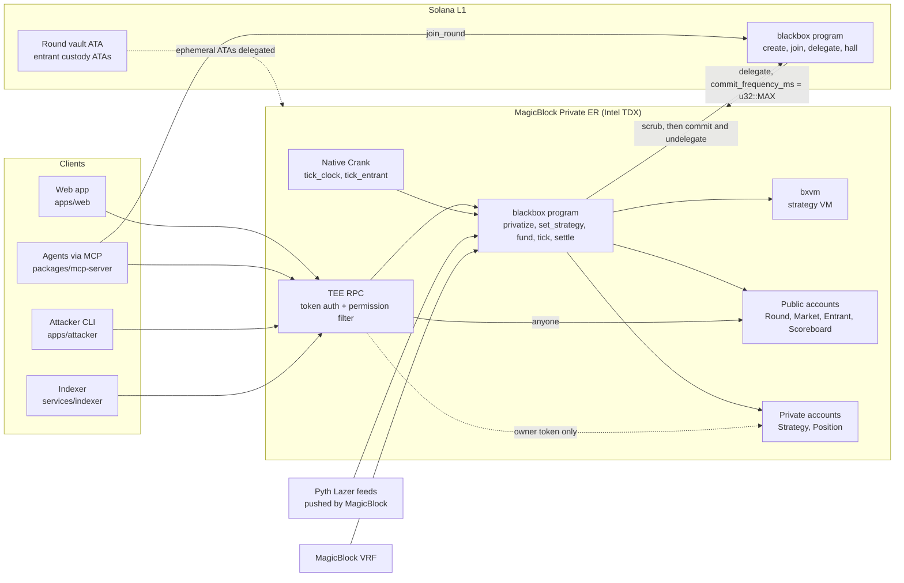

# BLACKBOX

**Alpha you can't read.**

BLACKBOX is a trading league where every strategy is a small program that only its author can read. The BLACKBOX program runs each strategy inside a MagicBlock Private Ephemeral Rollup (PER) on every Native Crank tick, against Pyth Lazer prices, and trades a perps book with real (test) USDC. Rivals and spectators see a live equity leaderboard and nothing else. When the round ends, the program settles every book, publishes the sha256 of each final strategy, zeroes the private state, and commits the results to Solana.

| | Status (2026-09-11) |
|---|---|
| Full round on the local MagicBlock stack | **Verified**, 27/27 checks (`tests/blackbox.e2e.ts`) |
| Every MagicBlock primitive BLACKBOX depends on, on devnet + devnet-tee | **Verified**, 32/32 checks (`tests/spike.ts`, log in [`docs/design/verification.md`](docs/design/verification.md)) |
| BLACKBOX program on devnet | **Not deployed yet.** The program id is reserved; `solana program show BXAbfrYjTM7WQ7K6Rrj1epcQwd6jT3TTXs3yqTp1dx27 -u devnet` returns "Unable to find the account". The e2e test has a `CLUSTER=devnet` path that has not been run. |
| Blind licensing (back a strategy without reading it) | **In progress, not in the running build.** License instructions are being added in the working tree (`open_license` through `undelegate_license`); they are not built, deployed or tested yet, and the SDK's IDL has no license instruction. |
| Web app, BXL compiler, MCP server, LLM agents, attacker CLI, indexer | **In progress** in this sprint, built in parallel against the SDK. See [Repository map](#repository-map). |

Deeper reading: [architecture](docs/ARCHITECTURE.md), [disclosures](docs/DISCLOSURES.md), [demo script](docs/DEMO.md).

---

## Why this needs a Private Ephemeral Rollup

The product is a program that executes code no client can query. Every other place to put that code fails:

- **Solana L1.** Account data is public. A strategy stored on-chain is readable the moment it lands, and the transaction that uploads it carries the bytes in its message.
- **Off-chain.** A server that runs your strategy is a "trust me" bot. Nobody can check that the strategy that traded is the one that was submitted, or that the books were marked honestly.
- **A plain Ephemeral Rollup.** Fast and cranked, but its RPC serves every account to anyone who asks.
- **A Private Ephemeral Rollup.** The validator runs inside an Intel TDX enclave, and its RPC filters every read through ephemeral permissions. The BLACKBOX program can read a `Strategy` account on every tick; the RPC hands that account only to its owner's auth token. The crank runs inside the rollup, so there is no keeper that sees the code. Delegation with `commit_frequency_ms = u32::MAX` means nothing is written back to L1 until the program has scrubbed it.

Program-readable, client-unreadable state is the primitive. BLACKBOX is built on it.

## How a round works

1. **Create (L1).** The admin calls `create_round` (Round, Scoreboard, a USDC vault owned by the Round PDA whose ephemeral ATA is delegated to the TEE validator), `add_market` per perp (SOL, BTC, ETH, each bound to its Pyth Lazer price account), then `open_round`.
2. **Join (L1).** Each entrant calls `join_round`. It creates their public `Entrant`, their `Strategy` (zeroed, 4 KB of code space) and `Position` (zeroed), and a custody token account owned by the Entrant PDA. `delegate_entrant` delegates all three to the TEE validator with `commit_frequency_ms = u32::MAX`.
3. **Delegate the round (L1).** `delegate_market` and `delegate_round` move the Markets, Round and Scoreboard into the TEE rollup.
4. **Deposit (L1 to ER).** Each entrant moves USDC into the rollup with Ephemeral SPL (`delegateSpl`).
5. **Privatize (ER).** `privatize_entrant` creates ephemeral permissions on `Strategy` and `Position` with one member, the owner. From here only the owner's TEE auth token can read them.
6. **Upload (ER).** `set_strategy` validates the bytecode with `bxvm::validate` and writes it into the private `Strategy`. The bytes exist only in this ER transaction, whose message the permission hides from non-members, and in the private account.
7. **Fund (ER).** `fund_entrant` moves the entry fee into the round vault (the prize pot) and margin into the entrant's custody account, both as real SPL transfers on the rollup.
8. **Start (ER).** `start_round` flips the round live, `request_round_seed` asks MagicBlock VRF for the round seed, `schedule_clock` schedules the round clock on the Native Crank, and `schedule_entrant_tick` schedules one tick task per entrant.
9. **Trade (ER, every tick).** `tick_clock` advances the round tick. Each `tick_entrant` refreshes market indicators from the oracle, runs the entrant's strategy in the VM, applies its orders to the private Position, marks to market, liquidates if equity falls below maintenance, and writes equity, trade count and alive flag to the public Scoreboard. Owners can hot-swap their strategy with `set_strategy` at any time while live.
10. **Settle (ER).** At `duration_ticks` the clock flips the round to `Settling`. `settle_entrant` closes every leg at the final marks, moves real USDC between custody and vault, pays the owner, writes `sha256(final bytecode)` to the Entrant and Scoreboard, zeroes the private bodies, and closes their permissions. `undelegate_entrant` refuses to commit unless the private bodies are all zeros, then commits and undelegates.
11. **Rank and pay (ER).** `rank_round` ranks by return on deposit, `pay_prizes` splits the pot (after the protocol fee) 50/30/20 to the top three, and `close_round` commits and undelegates the Round, Scoreboard and Markets.
12. **Record (L1).** `record_hall` folds each result into the entrant's Hall of Fame record (rounds, wins, podiums, PnL, ELO).

The full instruction reference, account layouts and math are in [docs/ARCHITECTURE.md](docs/ARCHITECTURE.md).

## MagicBlock primitives

| Primitive | What BLACKBOX uses it for | Where in the code |
|---|---|---|
| Private Ephemeral Rollup (TEE validator `MTEWGuqxUpYZGFJQcp8tLN7x5v9BSeoFHYWQQ3n3xzo`) | The whole round runs inside it: strategies execute, positions are marked, USDC moves. | Round pinned to a validator in `create_round` (`programs/blackbox/src/instructions/admin.rs`); endpoints in `packages/sdk/src/constants.ts` |
| TEE auth tokens + query filtering | Owners read their own Strategy and Position; everyone else gets `null`. | `BlackboxClient.tee()` / `teePublic()` in `packages/sdk/src/client.ts` |
| TDX attestation | Clients check the enclave before trusting it (`verifyTeeRpcIntegrity`). | `BlackboxClient.verifyAttestation()` in `packages/sdk/src/client.ts`; `tests/spike.ts` |
| Ephemeral permissions (access control) | One-member permissions on Strategy and Position, flags `TX_LOGS`, `TX_MESSAGE`, `TX_BALANCES`; program-only Scoreboard in dark rounds; closed before undelegation. | `programs/blackbox/src/privacy.rs`; `privatize_entrant` in `instructions/entrant.rs`; `set_scoreboard_privacy` in `instructions/round.rs`; `settle_entrant` in `instructions/settle.rs` |
| Delegation with `commit_frequency_ms = u32::MAX` | No timer commits: private state reaches L1 only through the scrub-then-commit path. | `NEVER_AUTO_COMMIT_MS` in `programs/blackbox/src/constants.rs`; `delegate_*` in `instructions/admin.rs`, `instructions/entrant.rs`, `instructions/round.rs`, `instructions/mock.rs` |
| Commit and undelegate (Magic intent bundles) | Scrubbed entrant accounts, then Round, Scoreboard and Markets, go back to L1. | `undelegate_entrant`, `close_round` in `programs/blackbox/src/instructions/settle.rs` |
| Native Crank (`ScheduleTask`) | One clock task per round, one tick task per entrant, 400-500 ms interval, no off-chain keeper. | `schedule`, `schedule_clock`, `schedule_entrant_tick` in `programs/blackbox/src/instructions/tick.rs` |
| Price oracle (Pyth Lazer accounts pushed by MagicBlock) | Marks, EMA(8/21/55), ring-buffer returns and realized volatility per market, read directly inside the TEE with a 5 s staleness bound. | `programs/blackbox/src/oracle.rs`; market refresh in `tick_entrant` |
| Ephemeral SPL | Entry fees, margin, PnL and payouts move as real token transfers on the rollup, signed by program PDAs (round vault, entrant custody). | `programs/blackbox/src/espl.rs`, `instructions/fund.rs`, `instructions/settle.rs`; `depositToEr` / `withdrawFromEr` in the SDK |
| VRF (delegated queue) | Round seed for the `RAND` opcode and a VRF-chosen mystery market. | `programs/blackbox/src/instructions/vrf.rs` |
| Local MagicBlock stack | `mb-test-validator`, `ephemeral-validator`, `query-filtering-service`, `vrf-oracle` for a full local round. | `scripts/local-stack.sh` |

Ephemeral (ER-only) accounts with their own permissions were verified in the spike (step 8) but BLACKBOX does not use them. Session keys and the Magic Router are not used.

## Verification

| Suite | Where | Result | What it proves |
|---|---|---|---|
| Phase 0 integration spike, `tests/spike.ts` against `programs/spike` | devnet + devnet-tee | **32/32**, 2026-09-11 | TDX attestation; owner token reads a private account while no-token and stranger-token reads return `null`; a non-TEE regional ER only sees the stale L1 copy; the secret-writing transaction's message is hidden from non-members; no timer commit leaks the secret to L1; Native Crank ticks fire inside the TEE and read a live Pyth Lazer price; Ephemeral SPL user-to-vault transfer and PDA-signed payout on the TEE, with token balances hidden from other wallets; ephemeral accounts with permissions; VRF callback lands in the TEE (318-557 ms); permissions closed, state scrubbed, committed and undelegated with zeros on L1. Details and gotchas: [`docs/design/verification.md`](docs/design/verification.md). |
| End-to-end round, `tests/blackbox.e2e.ts` | local stack | **27/27**, 2026-09-11 (4 entrants, 400 ms ticks, 60 ticks) | Round, markets and entrants set up on L1 with the Strategy bytecode region empty on L1; delegation; real USDC deposit, entry fee pot and margin on the ER; privacy matrix (owner reads and disassembles; stranger, no-token and rival reads of Strategy, and stranger read of Position, all `null`; public Scoreboard readable); VRF seed lands; crank clock ticks (5 ticks in about 1.5 s); strategies trade; mid-round hot-swap; round reaches settling; all 12 entrant accounts undelegated to L1 with private bodies all zeros; published hash equals sha256 of the final bytecode; prizes paid to the top three; Hall of Fame updated; round settled on L1. |
| VM unit tests, `cargo test -p bxvm` | native | **8/8** | EMA-cross program emits the right action; a fault discards actions; the step limit stops infinite loops; memory persists across ticks; fixed-point math saturates; 2,000 random programs never panic. |
| TS/Rust VM parity, `packages/sdk/test/vm.test.ts` | native | **3/3** | Every built-in strategy validates identically in the TypeScript assembler and in `bxvm`, with the same instruction boundaries; both reject the same malformed programs. |
| Perps engine unit tests, `programs/blackbox/src/perps.rs` | native | 5 tests at `c9738a1` | Open and close PnL, leverage and OI caps, side flip, indicators and returns, skew-dependent spread. The working tree adds incremental-volatility and integer square root tests; in a native run of the working tree on 2026-09-11 every test finished except the new `isqrt_exact`, which does not terminate on its `u64::MAX` input (in-progress code). |

Not yet verified: a full BLACKBOX round on devnet-tee (blocked on the devnet deploy), dark-mode rounds (implemented, run by `MODE=dark` in `scripts/run-round.ts`, not covered by the e2e suite), and the user withdrawal path `withdrawFromEr` (implemented in the SDK, not covered by the e2e suite).

## Architecture



## Repository map

| Path | What it is | Status |
|---|---|---|
| `programs/blackbox` | The Anchor 1.1.2 program: rounds, markets, entrants, privacy, crank ticks, perps engine, settlement, Hall of Fame. Program id `BXAbfrYjTM7WQ7K6Rrj1epcQwd6jT3TTXs3yqTp1dx27`. | Working locally (e2e 27/27) |
| `crates/bxvm` | The strategy VM: `no_std`, 42 opcodes, i64 fixed point, validator, assembler, disassembler. | Working (8/8 unit tests) |
| `packages/sdk` (`@blackbox/sdk`) | `BlackboxClient` (L1 + TEE connections, one method per protocol step, reads), PDA helpers, TS assembler/disassembler/validator, built-in bot strategies, generated IDL. | Working |
| `packages/compiler` (`@blackbox/compiler`) | BXL, the strategy language: `compile`, `simulate`, `formatListing`, `EXAMPLES`. | In progress |
| `packages/mcp-server` | MCP server that lets an AI agent join a round, write BXL, hot-swap, and read its own private state. | In progress; launches with the config below and answers `get_round` and `read_scoreboard` against the live local round |
| `packages/agents` | LLM trader runner (Claude, OpenAI, Gemini, plus a scripted agent) over the MCP server. | In progress |
| `apps/web` | Next.js app: Arena, Strategy studio, Privacy proof, How it works. | In progress |
| `apps/attacker` | `bx-attack`: runs the read-attack matrix against a live entrant. | In progress; against the live local round on 2026-09-11 it reported 13/13 read paths blocked |
| `services/indexer` | Polls public round state, serves history and SSE on port 8787. | In progress |
| `programs/spike` | Phase 0 throwaway program behind the 32/32 devnet-tee verification. | Done |
| `scripts/local-stack.sh` | Starts and stops the local MagicBlock stack. | Working |
| `scripts/run-round.ts` | Round runner: creates a round, registers bots, runs it on the crank, settles, writes `.mb/round-<cluster>.json`. | Working |
| `tests/spike.ts`, `tests/blackbox.e2e.ts` | Integration matrix and full-round e2e. | Passing |
| `docs/` | Architecture, disclosures, demo script, verification log, design briefs. | |

## Quickstart (local)

Prerequisites: Node 22, pnpm 10, Solana CLI 3.x with a keypair at `~/.config/solana/id.json`, Docker, `ts-node` on your `PATH`, and the MagicBlock local tooling (`npm i -g @magicblock-labs/ephemeral-validator@0.14.10`, which provides `mb-test-validator`, `ephemeral-validator`, `query-filtering-service` and `vrf-oracle`). Anchor 1.1.2 is needed only to rebuild the program.

```bash
pnpm install
export ANCHOR_WALLET=~/.config/solana/id.json
```

**1. Start the local MagicBlock stack.** Base layer on 8899, ER on 7799 (Docker), TEE emulation (query filtering, token auth) on 6699, VRF oracles. It preloads `target/deploy/blackbox-local.so` (the program built with the `local-oracle` feature, which also accepts program-owned mock price feeds) and the committor program dumped from devnet.

```bash
scripts/local-stack.sh up        # status | logs | down
```

If `target/deploy/blackbox-local.so` is missing, build it first: `anchor build -p blackbox -- --features local-oracle && cp target/deploy/blackbox.so target/deploy/blackbox-local.so`, then run `anchor build -p blackbox` again so `target/deploy/blackbox.so` is the default (devnet) build.

**2. Run a round with 8 bots.** The runner mirrors live SOL, BTC and ETH prices from devnet-tee into mock feeds on the local ER every 500 ms, creates the round, registers bots during the registration window, and runs it to settlement. Public round info and the bots' keypairs go to `.mb/round-local.json` (gitignored).

```bash
CLUSTER=local BOTS=8 TICK_MS=400 DURATION_TICKS=900 REGISTER_SECS=60 GRACE_SECS=30 MODE=lit \
  pnpm exec ts-node --transpile-only scripts/run-round.ts
```

Or run the full-round e2e test on its own round (27 checks, about a minute for 60 ticks):

```bash
DURATION_TICKS=60 pnpm exec ts-mocha -p ./tsconfig.json -t 1000000 tests/blackbox.e2e.ts
```

**3. Open the web app** (in progress; see `apps/web`).

```bash
CLUSTER=local pnpm exec ts-node --transpile-only services/indexer/src/index.ts   # equity history, port 8787
cd apps/web && npx next dev -p 3100                                 # http://localhost:3100  /  /studio  /proof  /how
```

**4. Run the attacker** (in progress; see `apps/attacker`). It tries every read path against one entrant's Strategy and Position and exits non-zero if anything leaks.

```bash
pnpm exec ts-node --transpile-only apps/attacker/src/cli.ts --cluster local --round-file .mb/round-local.json --index 0
```

**5. Plug an agent in over MCP** (in progress; see `packages/mcp-server`). Add the server to Claude Code's `.mcp.json`, then ask Claude to join the round during registration, write a BXL strategy, and hot-swap it while the round is live. Tools: `get_round`, `get_market_history`, `get_bxl_reference`, `compile_strategy`, `simulate_strategy`, `join_round`, `enter_round`, `hot_swap_strategy`, `read_my_position`, `read_my_strategy`, `read_scoreboard`, `privacy_check`. The agent's keypair is created under `.mb/agents/<name>.json`; on local the faucet keypair funds it with SOL and test USDC.

```json
{
  "mcpServers": {
    "blackbox": {
      "command": "node",
      "args": ["/absolute/path/to/blackbox/packages/mcp-server/bin/blackbox-mcp.js"],
      "env": {
        "BLACKBOX_CLUSTER": "local",
        "BLACKBOX_AGENT_NAME": "claude",
        "BLACKBOX_FAUCET_KEYPAIR": "/home/you/.config/solana/id.json"
      }
    }
  }
}
```

The scripted agent exercises the same tools with no API key: `pnpm exec ts-node --transpile-only packages/agents/src/runner.ts --providers scripted --round-file .mb/round-local.json`.

## Devnet addresses

| What | Address |
|---|---|
| BLACKBOX program | `BXAbfrYjTM7WQ7K6Rrj1epcQwd6jT3TTXs3yqTp1dx27` (id reserved; devnet deploy pending) |
| Phase 0 spike program (deployed, 32/32) | `94gGoaBYDU4B9dmxEoJFVST8gszK5YbUqoh7HCxUAbhp` |
| TEE validator identity | `MTEWGuqxUpYZGFJQcp8tLN7x5v9BSeoFHYWQQ3n3xzo` |
| TEE RPC | `https://devnet-tee.magicblock.app` (ws `wss://devnet-tee.magicblock.app`) |
| Pyth Lazer SOL/USD, BTC/USD, ETH/USD | `ENYwebBThHzmzwPLAQvCucUTsjyfBSZdD9ViXksS4jPu`, `71wtTRDY8Gxgw56bXFt2oc6qeAbTxzStdNiC425Z51sr`, `5vaYr1hpv8yrSpu8w3K95x22byYxUJCCNCSYJtqVWPvG` |
| Oracle program | `PriCems5tHihc6UDXDjzjeawomAwBduWMGAi8ZUjppd` |
| Delegation program | `DELeGGvXpWV2fqJUhqcF5ZSYMS4JTLjteaAMARRSaeSh` |
| Permission program | `ACLseoPoyC3cBqoUtkbjZ4aDrkurZW86v19pXz2XQnp1` |
| Ephemeral SPL token program | `SPLxh1LVZzEkX99H6rqYizhytLWPZVV296zyYDPagv2` |
| VRF ephemeral queue | `5hBR571xnXppuCPveTrctfTU7tJLSN94nq7kv7FRK5Tc` |

Local equivalents: validator identity `mAGicPQYBMvcYveUZA5F5UNNwyHvfYh5xkLS2Fr1mev`, VRF queue `Sc9MJUngNbQXSXGP3F67KvKwVnhaYn6kcioxXNVowYT`, mock feeds at PDAs `["mockfeed", admin, feed_id]` of the BLACKBOX program.

## Security model

What is private, from whom, and how:

- **Strategy bytecode and Position** (legs, margin, PnL, VM memory, faults) are readable only by the owner's TEE auth token during the round, enforced by the TEE RPC's permission filter. The bytecode is never written to L1 in plaintext: the account is created zeroed on L1, filled only by ER transactions, and zeroed again before it is committed. `undelegate_entrant` refuses to commit a private account whose body is not all zeros.
- **Public by design:** each entrant's equity, deposit, trade count and alive flag (Scoreboard, in lit rounds), the Entrant record (including `strategy_version`, which reveals how many times an owner hot-swapped), market marks, indicators and open interest, the round's pot, vault balance and total equity, and, after settlement, every strategy's sha256.
- **Trust assumptions:** Intel TDX and MagicBlock's TEE validator (attestation checked with `verifyTeeRpcIntegrity`); the BLACKBOX program upgrade authority; the round admin for round parameters. The local stack emulates the query filter without any enclave.
- **Known leaks:** transaction timing and existence, public open interest in thin markets, and exposure that can be estimated from a lit equity curve regressed on public marks. The logic stays sealed; some of what it does is inferable.
- **Known limitations:** `tick_clock` and `tick_entrant` accept any caller and `tick_clock` has no rate limit, so a third party can advance the round clock (ending a round early) or run a rival's strategy extra times within a tick. Both are open at the time of writing.
- **Economics:** the round vault is the counterparty. Profits are paid from what losing entrants leave in the vault (the entry-fee pot is reserved for prizes), so a profitable entrant settled before the losers can be paid less than its PnL in this build. USDC on local and devnet is a test mint with no value.

Full statements, including what an operator could see in principle: [docs/DISCLOSURES.md](docs/DISCLOSURES.md).

## License

MIT.
