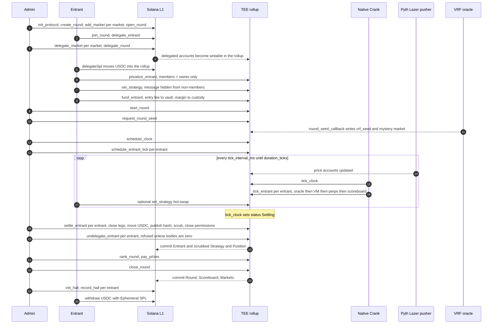

# BLACKBOX architecture

This document describes `programs/blackbox` and `crates/bxvm` at commit `c9738a1` (2026-09-11), which is the build running on the local stack and the one the 27/27 e2e run exercised. Everything here was read from that source; items that are designed but not implemented are listed at the end under [Not implemented](#not-implemented).

**Work in progress in the working tree** (not built, deployed or tested at the time of writing; this document will need an update when it lands): blind licensing instructions (`open_license`, `delegate_license`, `activate_license`, `schedule_license_tick`, `tick_license`, `settle_license`, `undelegate_license`), a shared tick path for entrant and license books, license fee pricing from each entrant's Sharpe accumulators into `Entrant.fee_price_bps`, and constant-cost realized volatility (`Market.ret_sq_sum` takes the 8 former padding bytes, so the Market size is unchanged).

Contents: [Layers](#layers) · [Accounts](#accounts) · [Instructions](#instructions) · [The tick loop](#the-tick-loop) · [The VM](#the-vm) · [Perps engine](#perps-engine) · [Privacy design](#privacy-design) · [Settlement and prizes](#settlement-and-prizes) · [Local vs devnet](#local-vs-devnet) · [Full round sequence](#full-round-sequence) · [Not implemented](#not-implemented)

## Layers

- **Solana L1** holds the protocol config and Hall of Fame permanently, and every round account before delegation and after the final commit.
- **MagicBlock Private Ephemeral Rollup (TEE)** holds every round account while the round runs. The same `blackbox` program executes there (programs are cloned into the ER, not delegated). All reads go through the TEE RPC, which authenticates a wallet with an auth token and filters accounts by their ephemeral permission.
- **Native Crank** (the ER's `ScheduleTask`) invokes `tick_clock` and `tick_entrant` on a timer inside the rollup.
- **Pyth Lazer price accounts**, pushed by MagicBlock into every ER, are read directly by `tick_entrant`.
- **MagicBlock VRF** answers `request_round_seed` with a callback inside the ER.
- **`bxvm`** is a Rust crate linked into the program. It executes strategy bytecode against a host view of markets and the entrant's position.

## Accounts

Sizes are the on-chain data lengths observed on the local stack (they include the 8-byte discriminator). Zero-copy accounts (`#[account(zero_copy)]`) are read and written in place through `AccountLoader`, never copied onto the 4 KB SBF stack.

| Account | Seeds (program `BXAb…dx27`) | Size | Delegated | Visibility during the round | Layout |
|---|---|---|---|---|---|
| `ProtocolConfig` | `["config"]` | 80 | no (L1 only) | public | admin, usdc_mint, protocol_fee_bps, paused, round_count, bump |
| `Round` | `["round", id as u32 LE]` | 651 | yes | public | status, mode, markets[8] config (feed, decimals, max_leverage, maintenance_bps, spreads, oi_cap), mystery_market, entry_fee, min/max margin, tick_interval_ms, duration_ticks, tick, step_limit, entrant/settled counts, live flag, vrf_seed, vrf_ready, pot, vault_balance, total_equity, timestamps, protocol and license fee bps, validator |
| `Scoreboard` (zero-copy) | `["board", round]` | 5680 | yes | public in lit rounds; program-only in dark rounds | n, finalized, entries[64] {owner, equity, deposited, trades, alive, rank, strategy_hash} |
| `Market` (zero-copy) | `["mkt", round, index as u8]` | 704 | yes | public | feed, oi_cap, oi_long, oi_short, funding_index, funding_rate_bps, mark, last_publish_time, last_tick, ring[64] of marks, ring_pos, ring_len, ema8, ema21, ema55, vol, maintenance/spread params, max_leverage, decimals |
| `Entrant` | `["ent", round, owner]` | 137 | yes | public | owner, index, batch/slot, joined_at, alive, deposited, strategy_hash (written at settlement), strategy_version, fee_price_bps, license_count, privatized, settled, hall_recorded |
| `Strategy` (zero-copy) | `["strat", round, owner]` | 4192 | yes | **private: owner only** | updated_tick, version, step_limit, len, bytecode[4096] |
| `Position` (zero-copy) | `["pos", round, owner]` | 528 | yes | **private: owner only** | margin, realized_pnl, legs[8] {size, entry, funding_index, side}, mem[16], Sharpe accumulators, last_equity, peak_equity, trade_count, last_steps, last_fault, last_fault_pc, liquidated |
| `Hall` | `["hall", wallet]` | 66 | no (L1 only) | public | rounds, wins, podiums, total_pnl, elo (starts at 1000), best_rank |
| `License` (zero-copy) | `["lic", …]` (reserved) | n/a | n/a | n/a | Layout reserved in `state.rs`; no instruction creates it. See [Not implemented](#not-implemented). |
| Mock price feed (local only) | `["mockfeed", authority, feed_id as u32 LE]` | 134 | yes | public | Byte-identical to a Pyth Lazer price account; accepted as a market feed only by the `local-oracle` build. |

Accounts owned by other programs:

| Account | Owner | Purpose |
|---|---|---|
| Round vault ATA `ata(mint, round)` and its ephemeral ATA | SPL Token / Ephemeral SPL | Holds the entry-fee pot and absorbed losses. The ephemeral ATA is initialized and delegated to the round's validator in `create_round`, so the TEE exposes a spendable token account at the ATA address. |
| Entrant custody ATA `ata(mint, entrant)` and its ephemeral ATA | SPL Token / Ephemeral SPL | Holds the entrant's margin. Delegated in `join_round`. |
| Permission PDAs `permissionPdaFromAccount(strategy / position / scoreboard)` | Permission program `ACLseo…Qnp1` | Ephemeral permissions. Each is paid for and controlled by the account it gates (the program signs with that account's seeds), so only the BLACKBOX program can change who may read it. |
| Pyth Lazer price accounts | Oracle program `PriCems…jppd` | 134 bytes; `price` i64 at offset 73, `publish_time` i64 at offset 93, 8 decimals (verified on devnet-tee, see `docs/design/verification.md` bet 1b). |

Fixed capacities (`constants.rs`): 8 markets, 64 entrants, 64-entry mark ring, 16 VM memory slots, 4096-byte bytecode, 8 licenses per author (reserved).

## Instructions

Signer names are the account names in the instruction's `Accounts` struct. "Anyone" means any wallet willing to pay the transaction fee.

### Solana L1

| Instruction | Signer | Requires | Effect |
|---|---|---|---|
| `init_protocol(protocol_fee_bps)` | admin | fee ≤ 2000 bps | Creates `ProtocolConfig` with the USDC mint. |
| `create_round(args)` | admin (config admin) | not paused; `min_margin > 0`, `max_margin ≥ min_margin`, `tick_interval_ms ≥ 100`, `duration_ticks > 0`, `1 ≤ step_limit ≤ 4096`, license fee bounds ≤ 1000 bps | Creates Round (`Created`), Scoreboard, the vault ATA; pre-funds Round and Scoreboard with permission rent; initializes and delegates the vault's ephemeral ATA to `validator`; pins the round to `validator`. |
| `add_market(index, cfg)` | admin | status `Created`; `index == n_markets < 8`; `1 ≤ max_leverage ≤ 100`; `50 ≤ maintenance_bps ≤ 5000`; `oi_cap > 0`; `decimals ≤ 12` | Stores the market config on the Round and creates the Market account bound to the price feed. |
| `open_round` | admin | status `Created`, at least one market | Status `Open`. |
| `join_round` | owner | status `Open`, fewer than 64 entrants | Creates Entrant, zeroed Strategy and Position, and the custody ATA; pre-funds permission rent on Strategy, Position and Entrant; initializes and delegates the custody ephemeral ATA. |
| `delegate_entrant` | owner | round's validator matches | Delegates Entrant, Strategy, Position with `commit_frequency_ms = u32::MAX`. |
| `delegate_market(round_id, index)` | admin | | Delegates one Market with `commit_frequency_ms = u32::MAX`. |
| `delegate_round(round_id)` | admin | round admin, status `Open`, validator matches | Delegates Round and Scoreboard with `commit_frequency_ms = u32::MAX`. |
| `init_hall` | payer | | Creates (idempotently) a wallet's Hall with ELO 1000. |
| `record_hall` | none | round `Settled` and committed, scoreboard finalized, not yet recorded | Folds one entrant's rank and PnL into their Hall. |

### Ephemeral Rollup (TEE)

| Instruction | Signer | Requires | Effect |
|---|---|---|---|
| `privatize_entrant` | owner | | Creates permissions on Strategy and Position: private, one member (the owner) with `TX_LOGS`, `TX_MESSAGE`, `TX_BALANCES`. Sets `entrant.privatized`. |
| `set_strategy(bytecode)` | owner | status `Open` or `Live`; entrant privatized; length ≤ 4096; `bxvm::validate(bytecode, n_markets)` passes | Writes the bytecode, bumps `version` (also mirrored to the public `Entrant.strategy_version`), records `updated_tick`. Used for the first upload and for hot-swaps. |
| `fund_entrant(margin)` | owner | status `Open`; total deposit within `[min_margin, max_margin]` | First call moves `entry_fee` from the owner's ER token account to the vault (pot and vault_balance grow); moves `margin` to custody; credits `Position.margin`. |
| `set_scoreboard_privacy(private)` | admin | | Creates or updates the Scoreboard permission with no members. `private = true` makes it program-only (dark round). |
| `start_round` | admin | status `Open`, at least one entrant | Status `Live`, `live = true`, `tick = 0`. |
| `request_round_seed(client_seed)` | payer | status `Live`, seed not set | Requests randomness from the VRF queue with a callback to `round_seed_callback`. |
| `round_seed_callback(randomness, client_seed)` | VRF program identity | | Stores `vrf_seed`, sets `vrf_ready`, `mystery_market = randomness[0] % n_markets`. |
| `schedule_clock(task_id)` | admin | status `Live` | Schedules `tick_clock` every `tick_interval_ms` for `duration_ticks + 1` iterations. |
| `schedule_entrant_tick(task_id)` | anyone | status `Live`; remaining accounts are exactly `[market_i, feed_i]` for every market, checked against PDAs and the Round's feeds | Schedules `tick_entrant` for this entrant for the rest of the round. |
| `tick_clock` | none (the crank; any caller is accepted) | | No-op unless `live`. Increments `tick`; at `duration_ticks` sets `live = false`, status `Settling`, `ended_at`. |
| `tick_entrant` | none (the crank; any caller is accepted, see `BlackboxClient.tickEntrant`) | | The core loop, described below. No-op unless `live`. |
| `settle_entrant` | anyone | status `Settling`, entrant not settled | Final close, USDC flows, hash publication, scrub, permission close. Described below. |
| `undelegate_entrant` | anyone | entrant settled; Strategy and Position bodies all zero | Commits and undelegates Entrant, Strategy, Position. |
| `rank_round` | anyone | status `Settling`, every entrant settled, not finalized | Ranks by return on deposit; sets `finalized`. |
| `pay_prizes` | anyone | scoreboard finalized, not yet paid; remaining accounts are the winners' token accounts in rank order | Pays the prize split from the vault. |
| `close_round` | anyone | prizes paid | Status `Settled`, then commits and undelegates Round, Scoreboard and the Markets passed as remaining accounts. |

### Injected by the MagicBlock SDK

`process_undelegation` is added to the program by the `#[ephemeral]` macro. The delegation program calls it on L1 when a delegated account is undelegated, to hand the account's committed data back to the BLACKBOX program. It is not called directly.

### Local development only

`init_mock_feed(feed_id, raw_price, decimals)` and `delegate_mock_feed(feed_id)` on L1, `set_mock_feed(raw_price, decimals)` on the ER. A mock feed is a program-owned account with the Pyth Lazer layout; its authority is stored in the `write_authority` bytes and checked on every update. Only a build with the `local-oracle` feature accepts program-owned feeds in `oracle::read_price`, so these instructions are inert on devnet.

## The tick loop

Two kinds of Native Crank task run for a live round, both at `tick_interval_ms` (400 ms in the e2e test, 500 ms in the running local round):

- **One clock task** (`schedule_clock`) runs `tick_clock`, the round's only clock. Round timing counts ticks, not slots or wall time.
- **One task per entrant** (`schedule_entrant_tick`) runs `tick_entrant` with accounts `[round, scoreboard, entrant, strategy, position]` plus `[market_i, feed_i]` for every market. A strategy that faults or runs out of steps affects only its own task.

The tasks are independent schedules at the same interval, so an entrant tick runs against whatever `round.tick` is current when it lands. Every task no-ops once `round.live` is false. The scheduled instruction deserializes the Round and Entrant raw from `UncheckedAccount` (the crank pattern) and writes them back explicitly.

**Caller checks.** Neither `tick_clock` nor `tick_entrant` requires a signer, and `tick_clock` has no rate limit: any wallet can send them on the rollup, not only the crank. A third party can therefore advance the clock (and end the round early) or run an entrant's strategy more than once per round tick. Market data refreshes only once per tick, so extra runs of a strategy that acts only on state changes do nothing. This is an open issue in this build; see [DISCLOSURES](DISCLOSURES.md) items 31-32.

`tick_entrant`, step by step (`programs/blackbox/src/instructions/tick.rs`):

1. **Markets.** For each market, check the Market belongs to this round and has the right index. If this is the first entrant to arrive for the current tick (`last_tick < tick`) or the market has no mark yet, read the oracle (`oracle::read_price`: key matches the configured feed, owner is the oracle program, price > 0, published at most 5 s ago, scaled from the feed's known decimals to 6 decimals) and update indicators: push the mark into the 64-entry ring, update EMA(8), EMA(21), EMA(55) (`ema += (mark - ema) * 2 / (n + 1)`, seeded with the first mark), recompute realized volatility over the ring. Every 240 ticks, accrue funding. A stale or invalid oracle fails the whole transaction, so that entrant skips the tick.
2. **Load private state.** Deserialize the Entrant; load the Strategy (read-only) and Position; check owners and round.
3. **Equity.** `margin + realized_pnl + Σ unrealized - Σ funding owed` at the current marks.
4. **Run the strategy** if the entrant is alive, not liquidated, has margin, and has code. The host exposes marks, EMAs, returns, volatility, the entrant's legs, equity, free margin (`equity - Σ size_i / max_leverage_i`, floored at 0), the tick, and a per-tick random value. The step limit is `min(strategy.step_limit, round.step_limit)`. On a fault, record `last_fault = fault + 1` and `last_fault_pc` and apply nothing. Otherwise apply each emitted action in order through the perps engine, recomputing equity after each.
5. **Maintenance.** If equity is below `Σ size_i * maintenance_bps_i / 10_000`, close every leg at fill prices, set `liquidated`, mark the entrant not alive. If equity is still negative, the vault absorbs the shortfall: `realized_pnl = -margin`, equity 0.
6. **Accumulators.** Per-tick return `(equity - last_equity) / last_equity` into `sum_ret`, `sum_ret_sq`, `ret_n`; update `last_equity` and `peak_equity`.
7. **Publish.** Write the Entrant back; write `equity`, `deposited`, `alive`, `trades` into the entrant's Scoreboard entry; recompute `round.total_equity` as the sum of all Scoreboard equities; write the Round back.

Nothing about the strategy, its legs or its memory leaves the private accounts. The public outputs of a tick are the Scoreboard entry, the Round's total equity and the Markets (marks, indicators, open interest).

## The VM

`crates/bxvm` is `no_std` with no allocation: fixed stack, fixed action list, `#![deny(unsafe_code)]`.

- **Values.** Every value is an `i64` in fixed point with 6 decimals: `1.0 = 1_000_000` (the same scale as USDC). Booleans are `1.0` and `0`.
- **Encoding.** A blob is a version byte (`1`) followed by instructions: one opcode byte plus fixed little-endian operands. Jump targets are absolute byte offsets into the code after the version byte.
- **Machine.** Stack of 64 values; 16 persistent memory slots stored in the private `Position.mem`; at most 8 actions per tick; a hard step limit (default 512, the round sets it, maximum 4096).
- **Validation** (`bxvm::validate`, run by `set_strategy`): version byte, length ≤ 4096, every opcode known and complete, jump targets on an instruction boundary (or exactly the end of code), market operands `< n_markets`, EMA window index `< 3`, return lookback `1..=64`, memory slot `< 16`, size bps `1..=10_000`. The SDK ships a byte-identical TypeScript validator, assembler and disassembler (`packages/sdk/src/vm.ts`), pinned by a parity test against the Rust crate.
- **Halting.** `HALT` or falling off the end of the code is a normal stop; the emitted actions are applied.

### Opcodes

`a b` in the stack column means `b` is on top. Arithmetic saturates at the `i64` range; `MUL` and `DIV` use an `i128` intermediate.

| Code | Mnemonic | Operands | Stack | Semantics |
|---|---|---|---|---|
| 0 | `NOP` | | | Nothing. |
| 1 | `HALT` | | | Stop normally. |
| 2 | `PUSH` | i64 (8 bytes) | `-> v` | Push an immediate. |
| 3 | `DUP` | | `a -> a a` | |
| 4 | `SWAP` | | `a b -> b a` | |
| 5 | `POP` | | `a ->` | |
| 6 | `ADD` | | `a b -> a+b` | Saturating. |
| 7 | `SUB` | | `a b -> a-b` | Saturating. |
| 8 | `MUL` | | `a b -> a*b/1e6` | Fixed-point multiply. |
| 9 | `DIV` | | `a b -> a*1e6/b` | Fixed-point divide; `b = 0` faults `DivByZero`. |
| 10 | `NEG` | | `a -> -a` | Saturating. |
| 11 | `ABS` | | `a -> abs(a)` | Saturating. |
| 12 | `MIN` | | `a b -> min` | |
| 13 | `MAX` | | `a b -> max` | |
| 14 | `LT` | | `a b -> a<b` | `1.0` or `0`. |
| 15 | `GT` | | `a b -> a>b` | |
| 16 | `EQ` | | `a b -> a==b` | |
| 17 | `AND` | | `a b -> a&&b` | Non-zero is true. No short circuit. |
| 18 | `OR` | | `a b -> a\|\|b` | |
| 19 | `NOT` | | `a -> !a` | `1.0` if `a == 0`, else `0`. |
| 20 | `JMP` | u16 target | | Unconditional jump. |
| 21 | `JZ` | u16 target | `a ->` | Jump if `a == 0`. |
| 22 | `JNZ` | u16 target | `a ->` | Jump if `a != 0`. |
| 23 | `PRICE` | market u8 | `-> mark` | Mark price, USDC 6dp. `NoData` if the market has no mark. |
| 24 | `EMA` | market u8, window u8 | `-> ema` | Window index 0, 1, 2 selects EMA(8), EMA(21), EMA(55) of the mark. `NoData` before the first mark. |
| 25 | `RET` | market u8, lookback u8 | `-> r` | Return over the last `n` ticks (`1..=64`) as a fraction (`0.01 = 10_000`). `0` until the ring has enough history. |
| 26 | `VOL` | market u8 | `-> vol` | Realized volatility over the ring, fraction per tick. |
| 27 | `POS` | market u8 | `-> notional` | Signed notional of the entrant's leg (positive long, negative short, 0 flat). |
| 28 | `ENTRY` | market u8 | `-> px` | Entry price of the leg, 0 if flat. |
| 29 | `EQUITY` | | `-> equity` | Equity at current marks. |
| 30 | `FREEMARGIN` | | `-> free` | Free margin: equity minus initial margin in use, floored at 0. |
| 31 | `TICK` | | `-> tick` | Round tick (a plain integer). |
| 32 | `RAND` | | `-> r` | Per-tick value in `[0, 1.0)`: `sha256(vrf_seed, owner, tick)` mod 1e6. |
| 33 | `MLD` | slot u8 | `-> mem[i]` | Load a persistent memory slot. |
| 34 | `MST` | slot u8 | `a ->` | Store into a persistent memory slot. |
| 35 | `LONG` | market u8, bps u16 | | Emit: target a long of `bps` of buying power. |
| 36 | `SHORT` | market u8, bps u16 | | Emit: target a short of `bps` of buying power. |
| 37 | `CLOSE` | market u8 | | Emit: close the leg. |
| 38 | `CLOSEALL` | | | Emit: close every leg. |
| 39 | `LE` | | `a b -> a<=b` | |
| 40 | `GE` | | `a b -> a>=b` | |
| 41 | `MOD` | | `a b -> a rem b` | Remainder of the raw integers; `b = 0` faults `DivByZero`. |

The SDK disassembler prints mnemonics in lower case with operands decoded: `ema m0 w8` shows the window length, `long m0 3000bps` the size, `jz @34` the target offset.

### Faults

A fault stops execution and **discards every action** from that tick: a broken strategy never trades. Memory writes made before the fault are kept (useful for debugging). The code is stored in the private `Position.last_fault` as the fault's index plus one (0 means no fault), with `last_fault_pc`.

| `last_fault` | Fault | Cause |
|---|---|---|
| 1 | `BadVersion` | First byte is not `1`. |
| 2 | `BadOpcode` | Unknown opcode byte. |
| 3 | `Truncated` | Operands run past the end. |
| 4 | `StackUnderflow` | Pop from an empty stack. |
| 5 | `StackOverflow` | More than 64 values. |
| 6 | `DivByZero` | `DIV` or `MOD` by zero. |
| 7 | `BadJump` | Jump target beyond the code. |
| 8 | `BadMarket` | Market operand `≥ n_markets`. |
| 9 | `BadOperand` | EMA window, lookback, memory slot or size out of range. |
| 10 | `StepLimit` | Step limit reached. |
| 11 | `TooManyActions` | More than 8 actions in one tick. |
| 12 | `NoData` | The host had no value (market without a mark or EMA yet). |

Validated bytecode cannot produce faults 1-3 or 7-9; they exist because the executor never trusts its input (a pseudo-fuzz test runs 2,000 random programs).

### Sizing semantics

`LONG m bps` and `SHORT m bps` are **targets**, not orders. The target signed notional is

```
target = equity × max_leverage(m) × bps / 10_000        (negated for SHORT)
```

so `LONG 0 10000` asks for the maximum the market allows and `LONG 0 3000` on a 20x market asks for 6x equity. The engine then moves the leg from its current signed notional to the target (see below). An action changes the book only when the target differs from the current leg; because equity moves every tick, a strategy that re-emits `LONG` every tick will rebalance a little every tick and pay spread each time. The built-in strategies (`packages/sdk/src/strategies.ts`) act only on state changes (flat to in, side flips). `CLOSE` targets 0. A rejected increase (leverage or open-interest cap) is skipped silently; the tick continues.

## Perps engine

`programs/blackbox/src/perps.rs`: pure functions over `Market`, `Leg` and margin. Units: prices and USDC are 6-decimal integers; fractions (spread, skew, returns, volatility) are 6-decimal fractions; `*_bps` are basis points.

- **Legs are notional-denominated.** A leg stores `size` (USDC notional at entry), `entry` (fill price) and `side` (+1, -1, 0). Unrealized PnL is linear in the return: `side × size × (mark - entry) / entry`.
- **Skew** of a market: `(oi_long - oi_short) / oi_cap`, clamped to `[-1, 1]`.
- **Spread:** `base_spread_bps / 10_000`, plus `skew_spread_bps × |skew| / 10_000` when the trade increases the skew (buying into a long-heavy market or selling into a short-heavy one), capped at 20%.
- **Fill price:** `mark × (1 + spread)` when buying, `mark × (1 - spread)` when selling. Closing a long sells; closing a short buys.
- **`trade_to_target(target)`:**
  1. If `target` equals the current signed notional, do nothing.
  2. Settle funding accrued on the existing leg into realized PnL and reset its funding index.
  3. If `|target|` exceeds the current `|notional|`, require `|target| + notional of all other legs ≤ equity × this market's max_leverage`. Reducing or closing is always allowed, even for an underwater book.
  4. **Reduce** toward zero (a flip first reduces to zero): realize `closed × side × (fill - entry) / entry` at the closing side's fill price.
  5. **Increase** away from zero: require the side's open interest plus the added notional `≤ oi_cap`; a fresh leg takes the fill as entry, an existing one takes the notional-weighted average `(old × entry + added × fill) / (old + added)`.
  6. Apply the open-interest deltas to the Market. Count one trade if anything moved.
- **Funding:** every 240 ticks, `funding_index += skew × 10 bps` (a fully long-skewed market charges longs 10 bps of notional per period). A leg owes `side × size × (funding_index - leg.funding_index)`, which equity subtracts continuously and `trade_to_target` realizes. `funding_rate_bps` on the Market is the last period's rate, rounded to whole bps.
- **Equity:** `margin + realized_pnl + Σ unrealized - Σ funding owed`.
- **Maintenance requirement:** `Σ size × maintenance_bps / 10_000`. Liquidation is checked inside the same tick as the strategy (no separate sweep).
- **Realized volatility:** `sqrt(mean(r_i²))` over consecutive returns in the 64-mark ring (per tick, not annualized).
- **Counterparty:** there is no order book and no external liquidity. Every fill is against the round vault, which collects spread and the losses of losing entrants and pays the profits of winning ones at settlement. See [Settlement and prizes](#settlement-and-prizes) and [DISCLOSURES](DISCLOSURES.md).

## Privacy design

**Permissions.** `privatize_entrant` creates one ephemeral permission per private account through the permission program, with `is_private = true` and a single member (the owner) carrying `TX_LOGS`, `TX_MESSAGE` and `TX_BALANCES`. The gated PDA is both the rent payer and the permission's authority; the program signs with the PDA's seeds, so no wallet (including the admin) can add a reader. The TEE RPC then returns the account only to the owner's auth token, and returns `null` to requests with no token or with any other wallet's token. `TX_MESSAGE` hides the instruction data of transactions that touch the account from non-members, which covers the `set_strategy` transaction that carries the bytecode.

**Order of operations.** `set_strategy` is rejected until `entrant.privatized` is set, so bytecode can never be written to a Strategy that is still public.

**Nothing on L1 in plaintext.** The Strategy is created on L1 with a zeroed body and delegated before any bytecode exists; the bytecode arrives only in ER transactions. The e2e test checks that the L1 copy's bytecode region (offset 96 onward) is all zero after delegation.

**`commit_frequency_ms = u32::MAX`.** Every delegation in the program (`NEVER_AUTO_COMMIT_MS`) disables timer commits, so the ER never writes a private account back to L1 on its own. The spike verified that a secret written on the ER does not appear in the L1 copy.

**Scrub before commit.** `settle_entrant` zeroes every byte after the discriminator of Strategy and Position (`privacy::scrub`), then closes both permissions (rent returns to the PDAs). Closing first matters: the spike found that a permission survives `commit_and_undelegate` and keeps enforcing privacy after re-delegation, but blocks creating a new one.

**The undelegate guard.** `undelegate_entrant` refuses to run unless the entrant is settled and both private bodies are all zeros. A bug elsewhere cannot commit a live strategy to L1 through this path.

**What stays verifiable.** Before scrubbing, `settle_entrant` writes `sha256(bytecode[..len])` into the public Entrant and the Scoreboard. Anyone who is later shown the code can check it against the hash; the e2e test checks the published hash against the final bytecode.

**Money.** Custody and vault token accounts on the TEE are synthesized SPL accounts at the ATA addresses; the TEE shows a token account only to its owner's token (spike bet 3). Balances therefore stay private by default, and the program exposes only aggregates: `Round.pot`, `Round.vault_balance`, `Round.total_equity`, and per-entrant `deposited` and `equity`.

**Dark rounds.** `set_scoreboard_privacy(true)` gives the Scoreboard a permission with no members: only the program can read it until `close_round` commits it to L1. The Round (including `total_equity`), Markets and Entrants stay public.

## Settlement and prizes

`tick_clock` flips the round to `Settling` at `duration_ticks`. Then, per entrant (`settle_entrant`):

1. Close every open leg at the final marks through `trade_to_target(0)` (closing fill, funding settled), accumulating realized PnL. Final equity is `max(0, margin + realized_pnl)`.
2. Move real USDC on the ER, PDA-signed:
   - loss: `min(|realized_pnl|, custody balance)` from custody to the vault;
   - profit: `min(realized_pnl, vault balance - pot)` from the vault to custody (the pot is reserved for prizes);
   - then the whole custody balance to the owner's token account.
3. Write `sha256(final bytecode)` and the final equity to the Entrant and Scoreboard; mark the entrant settled and not alive.
4. Scrub Strategy and Position; close their permissions.

`undelegate_entrant` then commits and undelegates the Entrant and the scrubbed Strategy and Position.

**Ranking** (`rank_round`, once every entrant is settled): by return on deposit, `equity / deposited` (the entry fee is not part of the deposit). Entrants with no deposit rank last; ties go to the lower index.

**Prizes** (`pay_prizes`): `fee = pot × protocol_fee_bps / 10_000` (500 bps in the scripts), `distributable = pot - fee`, split 50% / 30% / 20% to ranks 1-3. With fewer than three entrants the unused shares go to first place. Prizes are SPL transfers from the vault to the winners' token accounts on the ER. Afterwards `Round.pot` holds the protocol fee, which stays in the vault (no sweep instruction exists yet). In the e2e run, 4 entrants × 5 USDC entry fee paid 9.5, 5.7 and 3.8 USDC.

**Close** (`close_round`): status `Settled`, then commit and undelegate Round, Scoreboard and Markets. Winners and everyone else withdraw their USDC from the ER to L1 with Ephemeral SPL (`BlackboxClient.withdrawFromEr`: undelegate the ephemeral ATA on the ER, then `withdrawSpl` on L1). This path is implemented in the SDK but not covered by the e2e test.

**Hall of Fame** (`record_hall`, L1): increments rounds, wins (rank 1), podiums (rank ≤ 3), adds `equity - deposited` to total PnL, keeps the best rank, and updates ELO with K = 32 against a mid-table expectation: `score = (n - rank) × 1000 / (n - 1)`, `elo += 32 × (score - 500) / 1000`. A 4-entrant winner gains 16 (1000 to 1016 in the e2e run).

## Local vs devnet

| | Local (`scripts/local-stack.sh`) | Devnet |
|---|---|---|
| Base layer | `mb-test-validator` on 8899 (preloads the delegation, permission, Ephemeral SPL, VRF and session-key programs), plus the committor program `ComtrB2KEaWgXsW1dhr1xYL4Ht4Bjj3gXnnL6KMdABq` dumped from devnet (needed to commit large accounts through buffers) and the BLACKBOX build preloaded at its program id | `https://api.devnet.solana.com` |
| Rollup | `ephemeral-validator` 0.14.10 in Docker (it needs `RLIMIT_NOFILE` 1e6, set with `--ulimit`), identity `mAGicPQYBMvcYveUZA5F5UNNwyHvfYh5xkLS2Fr1mev`; raw RPC on 7799 has no read filter and is not exposed in production | MagicBlock's TEE validator `MTEWGuqxUpYZGFJQcp8tLN7x5v9BSeoFHYWQQ3n3xzo` (Intel TDX) |
| Private reads | `query-filtering-service` on 6699: the same auth-token and permission filter, **no enclave and no attestation**; `BlackboxClient.verifyAttestation()` returns `true` without checking on local | `https://devnet-tee.magicblock.app`, TDX attestation via `verifyTeeRpcIntegrity` |
| Program build | `local-oracle` feature (`target/deploy/blackbox-local.so`) | default features |
| Prices | Mock feeds: program-owned PDAs with the exact Pyth Lazer layout, delegated to the ER. `scripts/run-round.ts` and the e2e test read real SOL, BTC, ETH prices from the devnet-tee Pyth Lazer accounts every 2 s and write them into the mock feeds every 500 ms. | Pyth Lazer accounts pushed by MagicBlock every 50-200 ms |
| VRF queue | `Sc9MJUngNbQXSXGP3F67KvKwVnhaYn6kcioxXNVowYT`, served by two local `vrf-oracle` processes (base and ER) | `5hBR571xnXppuCPveTrctfTU7tJLSN94nq7kv7FRK5Tc` |
| USDC | A 6-decimal test mint created by the admin | A 6-decimal test mint created by the admin (not Circle's devnet USDC) |
| Status | Full round verified, 27/27 | Primitives verified with the spike, 32/32; BLACKBOX program not yet deployed |

## Full round sequence



## Not implemented

Designed, with account space reserved, but not in this build:

- **Blind licensing.** `License` (seed prefix `"lic"`), `Entrant.fee_price_bps`, `Entrant.license_count`, `Round.license_fee_min_bps` / `license_fee_max_bps`, `MAX_LICENSES_PER_AUTHOR` and the `LicenseLimit` / `LicenseInactive` errors exist; no instruction creates or ticks a license.
- **Mid-round checkpoints.** `Round.checkpoint_every_ticks` is stored but nothing commits on it.
- **Mystery market.** The VRF callback picks `mystery_market`; nothing reads it yet.
- **Batched ticks.** `batch`, `slot` and `batch_count` are computed; ticks run one task per entrant.
- **Vault sweep and custody undelegation.** The protocol fee and any residual vault balance stay in the round vault, and the vault and custody ephemeral ATAs stay delegated after `close_round`.
- **Two-pass settlement.** Profits are capped by the vault balance at the moment each entrant settles (see [DISCLOSURES](DISCLOSURES.md)).
